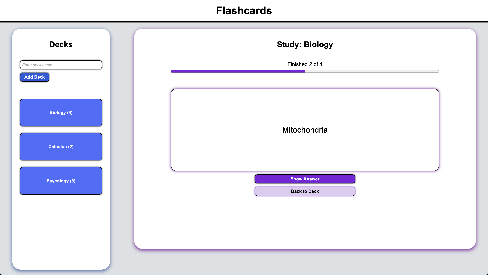

# Flashcards

A flashcard web app that lets you create decks of cards. You rate each card, and the more you struggled, the sooner it comes back.

[Live demo](https://alexander-flashcards.vercel.app/)



## Features
- Add and delete decks and flashcards
- Save decks automatically in the browser
- Edit flashcards
- Start a study session with the flashcards
- Progress bar tracking current session's mastered cards

## Study Queue Algorithm
Instead of using the SM-2 algorithm, which schedules reviews days apart, this app uses a study queue where cards come back in the same sitting. 
- Study queue is created of all of the cards in the selected deck when study session starts.
- You can rate the card either "I don't know.", "I struggled.", or "I got it!" after every answer reveal.
- Each rating corresponds with the number of cards shown before selected card shows up again (shown in table below).
- Rating a card "I don't know." adds one to the "misses" counter, and cards with the most "misses" come up first during the next session.
- A card rated "I got it!" three times in a row is considered mastered. The "misses" decrease by one and the card is removed from the session's queue.

|                                   | I don't know. | I struggled. | I got it! |
| --------------------------------- | ------------- | ------------ | --------- |
| Number of cards before it returns |       3       |      5       |     8     |

## Tech Stack
- HTML, CSS, plain JavaScript (no frameworks or backend)
- localStorage - decks stored in the browser, so data stays on one device and is lost if the site data is cleared
- Hosted on Vercel

## Testing
The study logic has unit tests that use the `assert` module in Node.js. The tests require installing [Node.js](https://nodejs.org).
The tests cover the ratings, streaks and misses, intervals, and the mastery condition.

Run the tests from the project folder:
```bash
node study-test.js
```

It prints "All tests passed." if all tests succeed.